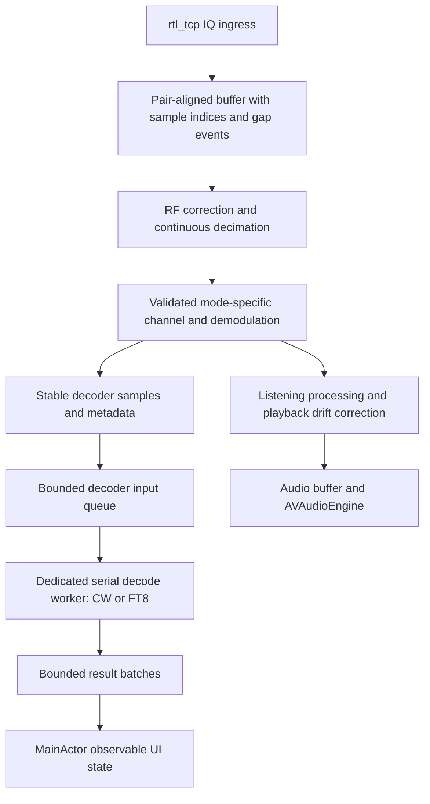

# CW and FT8 decoding implementation plan

Reviewed 6 November 2026 against CoronaSDR commit `ee7ced8dcc5e884bdaf70ee9cc9e3d7bd7348c83`.

**Recommendation:** repair sample continuity and channel filtering first; add a decoder input independent of playback; ship CW and FT8 behind separate acceptance gates. Do not commit to a decoder sensitivity, device baseline, background guarantee, or delivery date before measurement.

This is a proposed engineering and UX design. Current behavior below is established by source inspection and the explicitly described host-side checks. Proposed behavior is not a claim about existing functionality. No app implementation was changed during planning.

## 1. Verified starting point

| Finding | Evidence | Consequence |
|---|---|---|
| Swift 6, iOS 18 minimum, SwiftUI, local Swift Package targets; app targets iPhone and iPad. | `SDRApp/Package.swift`, `SDRApp/project.yml` | Extend the existing app and DSP package. |
| CW currently produces audio by wrapping USB demodulation; it has no text decoding. | `Demodulators.swift:414`, `Enums.swift` | CW listening and Morse decoding need separate controls. |
| USB/LSB have an internal AGC, independent of the pipeline's optional audio AGC. | `Demodulators.swift:363–401` | A tap before the optional pipeline AGC is still after another AGC. Explicitly control the internal AGC for decoder operation. |
| Playback resampling ratio responds to audio-buffer fill. Later stages apply tone filters and clipping. | `DSPPipeline.swift:352–455`, `Resampler.swift` | Decoder samples must branch before these listening adjustments. |
| The receiver header and raw IQ stream contain no capture timestamp or source sequence counter. | `RTLTCPProtocol.swift`, `RTLTCPConnection.swift:324` | Reception time and unreported upstream sample loss cannot be established exactly from this transport. |
| The app allocates 12,288,000 IQ bytes, roughly six seconds of capacity at 1.024 MS/s, and five seconds of playback capacity. | `RadioViewModel.swift:120–123` | Capacity is not measured latency. Neither playback timing nor current callback time identifies when the antenna received a sample. |
| Retuning discards samples; thermal policy can change sample rate and flush buffers. | `RTLTCPConnection.swift:370`, `RadioViewModel.swift:471,802` | Decoder input needs explicit discontinuity and configuration events. |
| Start/stop currently joins audio playback and DSP lifetime. | `RadioViewModel.swift:306–408` | Separate receiving, decoding, and audible monitoring where silent foreground decoding requires it. |

### Reproduced prerequisites

An isolated Swift check executed the repository's unmodified `IQRingBuffer`, `FIRFilter`, and `ChannelFilterDesigner` implementations on the host. These are algorithm checks, not iPhone RF measurements.

1. **IQ overflow can break sample pairing.** With capacity 8, writing bytes 0…5 and then 6…9 retains `[3,4,5,6,7,8,9]`. Both writes are even-sized, but the first retained byte is Q rather than I. The buffer drops arbitrary byte counts (`IQRingBuffer.swift:81`). Fix pair alignment, bounded oversized writes, and exact dropped-pair accounting. Preserve a partial pair across arbitrary TCP chunks; align settle-window discard behavior too.
2. **Decimation is not invariant to block boundaries.** A one-tap filter with decimation factor 21, processing samples 0…16383, produces value 8190 at output index 390 in one call and 8192 when split into two 8192-sample calls. `FIRFilter.swift:72` floors each block independently and does not preserve decimation phase. The production 1.024 MS/s configuration uses factor 21 and up to 8192 IQ pairs per block. Preserve decimator phase and pending input across calls; verify arbitrary block partitions against continuous processing.
3. **The CW bandwidth label does not establish narrow filtering.** At 1.024 MS/s and configured 500 Hz cutoff, the current design produces 127 taps. Evaluating those actual coefficients gives approximately −0.026 dB at 500 Hz, −0.105 dB at 1 kHz, −0.951 dB at 3 kHz, and −2.687 dB at 5 kHz, relative to DC. This is the channel FIR response only. Add effective narrow filtering at a lower sample rate and measure the complete chain. Do not call the present channel FIR a selective 500 Hz CW filter.

All three checks completed successfully and confirmed the stated behavior. They do not establish how often failures occur in live reception.

## 2. Proposed first release

- Receive-only, on-device decoding from the existing IQ connection.
- One selected decoder at a time: Off, CW, or FT8. This is a decoder selection separate from `DemodMode`; FT8 uses a USB receive configuration.
- CW decodes one selected signal; FT8 searches the validated audio passband for multiple signals.
- Foreground decoding, bounded session history, copy/share, and clear explanations for interrupted or unsupported input.
- No transmission, automatic replies, contact logging, remote spotting, cloud decoding, microphone input, or simultaneous multi-channel CW in this scope.
- Preserve CW audio listening without enabling text decoding. Stop decoding without disconnecting the radio. Muting monitoring must not alter foreground decoder samples.

These scope choices are recommendations. There is no evidence in this repository establishing requirements for continuous background decoding, specific decoder sensitivity, or a particular supported hardware floor.

## 3. Signal architecture

Keep decoder implementations in a `Decoding` folder inside `SDRCoreDSP` initially. Add one small C target, `CFT8`, only if the library evaluation passes. No general modem plug-in framework or new networking service is needed.

**Input contract.** Each owned block carries a session/configuration generation, first sample index, sample count, nominal sample rate, tuning snapshot, and explicit continuity status. Keep a monotonic timeline for elapsed time and a separately recorded mapping to estimated UTC. Distinguish measured, configured, and inferred values. Account for filter/resampler group delay. A nominal sample rate does not calibrate the receiver oscillator.

**Ownership and scheduling.** Decoder processing never runs on the audio callback, network callback, `MainActor`, or while holding the existing pipeline lock. Use preallocated, bounded handoff storage. The DSP producer performs only bounded work; the consumer owns C state and scratch memory. Do not enqueue a Swift task per audio block. Build spectra incrementally on the worker, then decode immutable completed windows while capture can continue into separate storage. Bound pending work; when overloaded, mark an affected window skipped and reacquire instead of accumulating latency. Check cancellation between candidates/passes and reject results from old generations even if a C call has already started.

**FT8 branch.** Use verified USB demodulation, explicit BFO policy, a measured passband, and a fixed nominal conversion to 12 kHz mono Float32. The initial evaluation passband is 200–3000 Hz, matching the candidate's example, not a protocol requirement. Design transition margins so the advertised usable band is actually passed. A 15-second mono Float32 buffer at 12 kHz is 180,000 samples / 720,000 bytes; overlap, spectra, scratch, and UI storage are additional.

Bypass the SSB demodulator's internal AGC in this mode and apply any desired listening gain after the branch. RF gain remains a front-end setting; record it and evaluate overload. The decoder must not inherit user tone controls, clipping, fades, mute, or the playback drift controller. Validate antialias filtering; reusing `Resampler` is acceptable only when the input is suitably band-limited for the new output rate.

**CW branch.** Retain the existing RF correction infrastructure, but explicitly separate carrier selection, receive bandwidth, and listening pitch. The current BFO is mixed before channel filtering; moving it can change what reaches the filter. Validate that a selected CW carrier stays in the decoder passband as listening pitch changes. Use a narrow low-rate filter and envelope detection, with adaptive noise threshold and hysteresis, followed by element-duration estimation and Morse parsing. Do not use uncalibrated display FFT bins as the decoder input.

## 4. FT8 timing and decoder selection

FT8 uses 15-second sequences and 79 symbols at 6.25 baud: 12.64 seconds of signal. WSJT-X uses USB and recommends UTC synchronization within ±1 second. These are reference-system facts, not proven CoronaSDR performance. [WSJT-X user guide](https://wsjt.sourceforge.io/wsjtx-main_en.html)

### Timing policy

1. Index samples continuously through transport and DSP; measure local buffer residence separately from network arrival time.
2. Retain a bounded rolling sample history and evaluate overlapping 15-second windows with bounded phase search. Fix the allowed delay/search envelope after replay experiments. A timer firing on local UTC alone is insufficient.
3. Preserve capture while decoding the preceding window. Reacquire after reconnect, retune, PPM change, sample-rate change, decoder overflow, or known IQ loss. A temporary TCP stall that later delivers contiguous samples is delayed data, not automatically missing data; treat it according to the measured deadline and backlog budget.
4. Invalidate affected windows rather than joining unrelated samples or silently removing gaps. Do not fabricate zero-filled data without an explicit, tested partial-window policy.
5. Detect wall-clock jumps independently of the monotonic sample timeline. Device clock error, sender clock error, network/server buffering, and DSP delay are different quantities. Observed FT8 timing offset cannot uniquely separate them.
6. Label estimated reception time as estimated. Do not expose precise transmitter DT until its definition and uncertainty are validated. If reliable absolute RF timestamps or detection of server-side drops is a requirement, the server protocol must change or decoding must occur at a timestamped receiver. That is a scope decision, not something client code can infer.

### Library decision

Evaluate `kgoba/ft8_lib` at commit `9fec6ca39886edbf96f4f5e71edc76da5074e871`, the head returned during this review. It is a candidate, not an approved production dependency.

- The top-level license is MIT; bundled KissFFT source identifies BSD-3-Clause. Inventory licenses for the exact compiled files and preserve notices. The repository also contains reference material that need not be shipped. [Pinned license](https://github.com/kgoba/ft8_lib/blob/9fec6ca39886edbf96f4f5e71edc76da5074e871/LICENSE), [KissFFT source](https://github.com/kgoba/ft8_lib/blob/9fec6ca39886edbf96f4f5e71edc76da5074e871/fft/kiss_fft.c)
- Its message dispatcher handles standard messages, nonstandard calls, free text, and telemetry; other types return an unsupported-type error. Test actual bit patterns, not the header's list of possible types. The README's future-work list is not an accurate substitute for the current implementation. [Pinned message implementation](https://github.com/kgoba/ft8_lib/blob/9fec6ca39886edbf96f4f5e71edc76da5074e871/ft8/message.c)
- Its example calculates a score-derived placeholder for SNR. Do not display that number as dB SNR. Implement and validate an estimator with the appropriate reference bandwidth, or omit the field. [Pinned example](https://github.com/kgoba/ft8_lib/blob/9fec6ca39886edbf96f4f5e71edc76da5074e871/demo/decode_ft8.c)
- Integrate the required C routines, not the example's executable, audio-device loop, global hash table, logging, or result-table logic. Bound all allocations, cache probing, candidate counts, strings, and result counts. Handle allocation and unpack failures. Prove that all retained state resets correctly across sessions.
- Accept a message only after the decoder's parity/CRC checks and successful supported-message unpacking. CRC success does not prove sender identity. Retain raw payload and message type for reproducibility; unknown hashed calls stay visibly unresolved. Use decoder field metadata instead of guessing callsign/grid positions by splitting strings.
- Deduplicate repeated candidates for the same physical decode within a slot using payload plus time/frequency locality; do not erase the same text transmitted in later slots or at distinct frequencies.
- Use WSJT-X on identical recordings as a reference and measure the gap by condition. Do not advertise WSJT-X-equivalent weak-signal sensitivity or exhaustive modern FT8 message support from library inclusion alone.

CoronaSDR's README distinguishes GPLv3 source distribution from the copyright holder's separately distributed App Store binary. Upstream WSJT-X is GPLv3-or-later. Reusing third-party GPL code requires a distribution decision; ownership of CoronaSDR does not settle rights in external contributions. This plan does not establish legal compatibility. [Local README](../README.md), [WSJT-X license statement](https://wsjt.sourceforge.io/wsjtx-main_en.html#_license)

## 5. CW behavior and limitations

Use a deterministic local decoder. Start with one selected carrier, adjustable tracking limits, automatic element-speed estimation, and a manual speed override. Use separate estimates for key-down timing and inter-character/word spacing so Farnsworth spacing and changing hand-sent rhythm can be evaluated. Reacquire on retune, loss of tone lock, or discontinuity.

Specify letters, digits, supported punctuation, and an explicit prosign representation. Preserve ambiguity where symbols share a pattern. Emit an uncertainty marker for undecodable elements; do not guess words, callsigns, or missing characters with language-model correction. Show estimated WPM only after enough timing evidence and mark it unavailable while acquiring. A numerical confidence percentage needs calibration; use descriptive states until then.

Evaluate machine-keyed audio, hand sending, speed changes, long gaps, fading, impulses, interference, and two nearby stations. Report character and word error rates separately. Single-signal CW decoding does not imply a CW skimmer. Fldigi provides a primary reference for adaptive thresholds, tracking, filtering, and spacing behavior, not a guarantee for this implementation. [Fldigi CW configuration](https://www.w1hkj.org/FldigiHelp/cw_configuration_page.html)

## 6. UX proposal

Extend the existing Radio screen with a **Decode** control and an expandable results panel. Selecting FT8 visibly applies its USB receive profile; selecting CW activates its CW profile. Preserve ordinary receiver preferences, and restore them on exit only where doing so will not overwrite subsequent explicit user changes. Saved decoder preference must not silently start a receiving session on launch.

| Area | CW | FT8 |
|---|---|---|
| Main result | Selectable transcript, uncertainty markers, estimated WPM | Messages grouped by receive interval, audio offset, clearly labeled time |
| Main action | Select/adjust one signal; tracking and speed controls | Start/stop decoder; select validated band preset or current compatible frequency |
| Status | Acquiring tone, tracking, no usable tone, interrupted | Collecting interval, decoding, no messages, interrupted, processing limit reached |
| Detail | Selected carrier, pitch, effective filter, speed override | Full message, parsed fields, RF/dial frequency context, supported-message status |
| Signal metrics | Descriptive lock/quality until calibrated | SNR and DT only if validated; otherwise explicitly unavailable |

**Interaction rules:**

- A blank result area never means both “working” and “broken.” Distinguish a complete interval with no decodes from a gap, overload, incomplete interval, or unsupported configuration.
- Show capture progress and processing status separately. Do not promise an exact result countdown when timing uncertainty or backlog prevents it.
- Pause automatic scrolling while the user reads older results; show a new-results indicator. Freeze display does not stop collection. Clear history does not stop receiving. Name these actions distinctly.
- Keep frequency and decoder status visible in compact iPhone layouts. Use an expanded side-by-side result layout on iPad where space permits. Retain numeric tuning alternatives to waterfall gestures.
- FT8 row selection opens details; it does not retune the whole receiver or suggest a transmit action. Band presets must reflect validated receiver coverage; an RTL tuner type is not proof of an HF-capable antenna/front end.
- Stop scanning when a decoder starts, with an inline explanation. Starting a scan stops decoding visibly. Route this through the common tuning coordinator so station selection, deep links, lock-screen next/previous, and RF controls follow the same reset rules.
- Support Dynamic Type, VoiceOver reading order and labels, text selection, contrast, and state indications beyond color. Announce status changes selectively; do not announce every CW character or every FT8 row. Validate on device with VoiceOver.
- Keep received content local unless the user explicitly shares it. Existing performance/crash telemetry must not acquire decoded text, callsigns, grids, or raw audio through new logs.

**Background policy:** propose foreground-only decoding for the first release, with an explicit paused state and fresh acquisition after returning. Preserve existing background listening. Do not use silent audio as an execution mechanism. Evaluate continued decoding during genuine background radio playback separately against iOS behavior, energy, and product requirements. Apple documents suspension and identifies silent audio as wasted background activity. [Apple background energy guidance](https://developer.apple.com/library/archive/documentation/Performance/Conceptual/EnergyGuide-iOS/WorkLessInTheBackground.html)

Usability validation is still required. Observe users starting each mode, interpreting an empty interval, adjusting a CW signal, muting monitoring, reading old results, retuning, and recovering from interruption. Record task completion and critical errors; do not invent personas or claim the proposed layout has been validated.

## 7. Delivery sequence and exit criteria

| Phase | Concrete work | Exit evidence |
|---|---|---|
| 0. Establish reference conditions | Choose supported receiver/server configurations and oldest target iPhone/iPad; obtain licensed clean/noisy CW and FT8 recordings; fix reference-decoder versions and settings. | Reproducible corpus, known messages, sample provenance, baseline measurements, and agreed quality/performance thresholds. |
| 1. Repair stream correctness | Fix IQ pair preservation, oversized writes, decimation phase, settle/discard events, and effective low-rate filters. | Arbitrary TCP chunk/block partition tests; exact sample counts; overflow/flush/gap tests; frequency and impulse response measurements. |
| 2. Add decoder input and lifecycle | Stable decoder branch, sample metadata, bounded worker, generation cancellation, monitor independence. | Same decoder input regardless of volume, tone controls, route changes, and playback fill; no stale results after any configuration transition. |
| 3. Deliver CW vertical slice | Detector, timing/parser, transcript, carrier selection, manual override, uncertainty and interrupted states. | Clean fixtures exact; error-rate curves for noisy/hand-keyed fixtures; successful tuning/pitch and accessibility tasks. |
| 4. Deliver FT8 vertical slice | Pin and wrap C library; sample-window acquisition; bounded phase search; message support matrix; result list. | Known messages match supported fixtures; parity/CRC failures rejected; unsupported types handled; measured comparison with WSJT-X. |
| 5. Validate on hardware | Release-build RF replay/live reception, thermal/energy profiling, interruption recovery, accessibility, memory soak, build/signing and notices. | Evidence meets the agreed matrix on every supported baseline configuration; explicit limitations in product help. |

CW may be released once its own gates pass; FT8 remains gated independently. Avoid delaying a reliable CW release for an unresolved FT8 timing or library decision.

### Required verification matrix

- **DSP:** multiple input rates, arbitrary block sizes, SSB image rejection, CW carrier/pitch/filter mapping, passband edges, alias rejection, sample-clock error, and clipping/AGC behavior.
- **Transport:** split IQ pairs, full/oversized writes, wraparound, delayed bursts, server disconnect/reconnect, retune settling, long backlogs, and known versus undetectable upstream losses.
- **FT8:** known standard/nonstandard/free-text/telemetry payloads, unresolved hashes, unsupported types, multiple signals, adjacent strong signals, SNR sweeps, frequency and time offsets, drift, incomplete windows, repeated transmissions, and noise-only false decodes.
- **CW:** supported characters and prosigns, variable weighting/speed, Farnsworth, silence, manual sending, QRM/QRN, fading, clipping, and carrier changes.
- **Lifecycle:** every tuning entry point, scan conflicts, sample-profile changes, Low Power Mode, thermal transitions, phone/audio interruptions, Bluetooth route changes, foreground/background transitions, clock jumps, and cancellation while decoding.
- **Resources:** decode latency distribution, sustained throughput, worst queue depth, peak/resident memory, audio underruns, thermal state and energy. A decoder must process sustained input without an ever-growing queue; choose user-visible latency and battery limits from measurements and product requirements.

Do not treat the candidate library's example memory size, desktop runtime, or published WSJT-X sensitivity as an iPhone acceptance result. Do not put a numeric quality claim in the release without the corresponding measurement.

## 8. Files and integration surface

- `Packages/RTLTCPClientKit`: ingress alignment, settle events, ring-buffer loss reporting and sample indexing.
- `Packages/SDRCoreDSP`: continuous FIR decimation, channel design, SSB AGC control, stable resampling, decoder classes and bounded worker.
- `Packages/AudioEngineKit`: monitoring lifecycle and interruption coordination where required; audio callback remains limited to playback.
- `App/SDRApp/ViewModels/RadioViewModel.swift`: receiving/decoding/monitoring state and all transition coordination. Use a small separate observable decoder view model for result presentation rather than expanding the existing coordinator with decoder internals.
- `App/SDRApp/Views/Radio`: decoder controls, results and details. `MainTabView.swift` participates in scene and restoration behavior.
- `Packages/SDRModels`: small decoder configuration/result value types where shared, with safe defaults for existing persisted settings. Preserve the meaning of `DemodMode` and existing station/CSV data.
- `Package.swift`, `project.yml`, generated Xcode project: C target and dependencies. The project currently declares device-only supported platforms; establish a separate host DSP test harness or explicitly validate simulator support and the existing liquid-dsp binary before promising simulator coverage.
- `Tests/CoronaSDRTests`: stream/DSP regressions, decoder corpus, cancellation, RF-control and playback-control regressions. Run relevant existing tests as well as new tests.
- `README.md`, `THIRD_PARTY_NOTICES.md`, release notes and help: supported message types, foreground policy, hardware coverage, signal-quality limitations, and exact third-party notices.

## 9. Decisions that remain open

1. Which real receiver/server/antenna combinations and minimum devices must pass?
2. What CW error rate and FT8 reference-relative decode yield are acceptable under specified conditions?
3. Is foreground decoding sufficient, or is screen-off operation a release requirement?
4. Is the verified subset of ordinary FT8 messages sufficient, or are contest/DXpedition and other variants required?
5. Are estimated interval times acceptable, or is absolute capture-time accuracy required?

These questions prevent a defensible delivery estimate and final dependency approval. They do not prevent starting the demonstrated stream and filtering repairs.

**Review limits:** no iOS build, live radio session, decoder benchmark, device thermal/battery measurement, or usability study was performed. Only the described host algorithm checks were executed. The plan intentionally omits transmission, remote reporting, maps, a generic decoder framework, and unrelated app refactoring.
